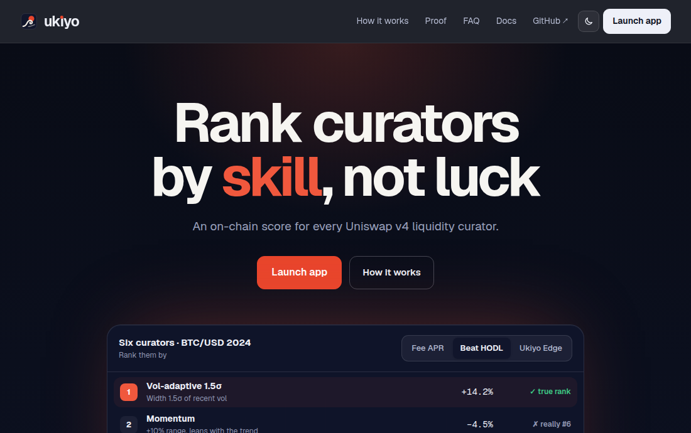
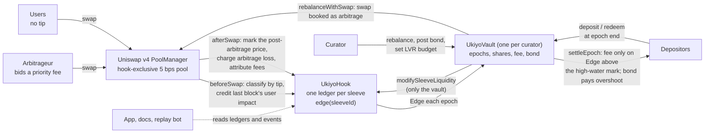
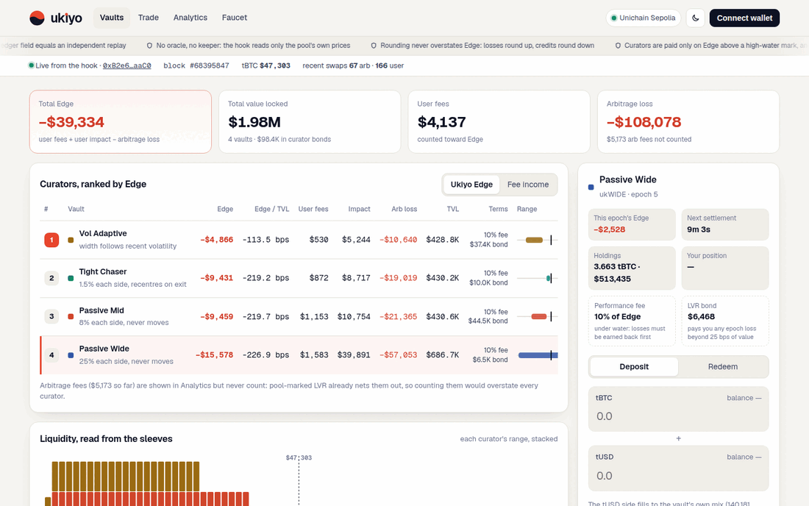
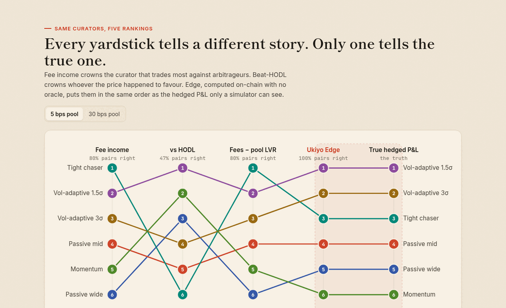

<p align="center"></p>

<h1 align="center">Ukiyo 浮世</h1>

<p align="center"><b>An honest scoreboard for curated liquidity on Uniswap v4.</b></p>



Ukiyo is a Uniswap v4 hook that measures, block by block and with no oracle, how much skill each liquidity curator
actually has. Every curator runs a hook-owned position ("sleeve") in a hook-exclusive pool, and the hook keeps a
ledger per sleeve:

```
Edge = user fees + user price impact − arbitrage loss
```

Built for the Uniswap Hook Incubator, cohort 11 (theme: *Active Management and Curation*).

**Live:** [ukiyo-ochre.vercel.app](https://ukiyo-ochre.vercel.app) · Unichain Sepolia hook
[`0x210799db053FcB7b9ac62A2F75f2B704a9F42Ac0`](https://sepolia.uniscan.xyz/address/0x210799db053FcB7b9ac62A2F75f2B704a9F42Ac0) · **Reviewing?** Start with
[`REVIEWERS.md`](REVIEWERS.md) (five minutes). **Integrating?** [`INTEGRATING.md`](INTEGRATING.md). **Built when?**
[`SUBMISSION.md`](SUBMISSION.md). **Feedback on v4:** [`FEEDBACK.md`](FEEDBACK.md). **One page, no maths:**
[`pitch/Ukiyo-Overview.pdf`](pitch/Ukiyo-Overview.pdf). **What's next:** [`ROADMAP.md`](ROADMAP.md).

## Highlights

1. **Skill measured on-chain, with no oracle.** The hook reads only its own pool's prices. On a full year of real
   BTC/USD prices its Edge has a 0.987–0.999 correlation with each curator's true hedged P&L, and it ranks six curators in
   exactly their true order. The obvious formula puts the wrong curator first ([backtest](#what-the-backtest-found-and-why-the-obvious-formula-is-wrong)).
   Out of sample, on four years of ETH (2021–2024), it picks the true best curator every year; fee income does so once
   ([four years of ETH](#out-of-sample-four-years-of-ethusdt)).
2. **It never flatters a curator.** Every rounding goes against the curator. A doubtful swap is booked as arbitrage. A
   tipped price spike that is pushed back is charged once, not twice
   ([`_isSpike`](src/UkiyoHook.sol#L785)). Liquidity is measured from where it joins, and a remove-and-re-add cannot reset
   that ([`unlockCallback`](src/UkiyoHook.sol#L488)). Vaults refuse to add capital away from a price no single
   transaction can set ([`_checkPrice`](src/UkiyoVault.sol#L1028)). A differential fuzz test replays every swap against an
   independent model.
3. **Curators are paid for Edge only.** A vault's performance fee is a share of Edge above a high-water mark. Fee
   volume and a rising market earn nothing. An LVR bond pays depositors when an epoch loses more than the curator's
   budget ([Curator vaults](#curator-vaults)).
4. **Skill, not luck.** Each vault compounds a size-neutral Edge index and publishes a t-statistic of its epoch returns
   ([`edgeTStat`](src/UkiyoVault.sol#L706)). At 2 or more, the Edge is statistically clear of zero. A curator whose
   index falls past its drawdown limit goes on probation and cannot rebalance ([`onProbation`](src/UkiyoVault.sol#L851)).
5. **Anyone can become a curator.** [`UkiyoFactory.launch`](src/UkiyoFactory.sol#L96) deploys a genuine vault (its
   code is hash-checked), opens its sleeve and posts a permanent bond in one call, with no permission from the hook
   owner.
6. **Invest by evidence.** [`UkiyoSkillRouter`](src/UkiyoSkillRouter.sol#L92) splits one deposit across curators by
   their skill tests. The depositor holds every share directly, and the router never holds anyone's funds.
7. **Live and measured.** The live board runs on Unichain Sepolia, with a bot replaying 2024 BTC prices through the
   pool. The classifier was measured on 6,714 real Unichain swaps, and the README reports where it falls short.

## Who it's for, and what it changes

Concentrated liquidity is increasingly run by curators: vault managers who choose and move ranges for depositors.
Depositors choose between them by the numbers dashboards show, mostly fee APR and returns against holding. Those numbers
reward volume and market direction, not management, so capital flows to the wrong curators. On the BTC/USD 2024 replay
(5 bps pool, full-year totals of weekly returns):

| Curator | Fee income | Fees − pool LVR (the obvious formula) | **Ukiyo Edge** | True hedged P&L |
| --- | --- | --- | --- | --- |
| Tight chaser (±1.5%) | **41,463 bps**, ranked 1st | 22,542 bps, 1st | 1,044 bps, 3rd | 1,328 bps, 3rd |
| Vol-adaptive (1.5σ) | 18,826 bps, 2nd | 11,838 bps, 2nd | **2,540 bps, 1st** | 2,806 bps, 1st |
| Momentum (±10%) | 5,857 bps, 5th | 2,694 bps, 5th | **−275 bps, the only loss** | −205 bps, the only loss |

Fee income puts the tight chaser first by more than twice the runner-up, though it is truly third, and shows the
momentum curator earning while it loses money. The obvious on-chain formula overstates the tight chaser 17×. Edge gets the order right and flags the loser. That
matters to three groups:

- **Depositors and allocators** pick curators by Edge return and its t-statistic instead of fee APR, or hand the choice
  to [`UkiyoSkillRouter`](src/UkiyoSkillRouter.sol#L92), which splits a deposit by the evidence.
- **Curators** get a track record nobody can dispute, because the pool computes it itself, and are paid a share of
  Edge rather than of volume. A good curator can launch through the factory and be ranked from its first epoch.
- **Vault platforms and aggregators** read every curator's ledger, Edge index, skill test and terms in one call
  ([`UkiyoLens.scoreboard`](src/UkiyoLens.sol#L100)) and can rank or route on it. The hook needs no oracle and no
  keeper, so it can run under any v4 pair on a chain that orders transactions by priority fee.

## Where the Uniswap v4 integration lives

Ukiyo is a standard-curve v4 hook (no custom curve, no return deltas, static fee), so any v4 router can trade its pool.

| What | Where | Notes |
| --- | --- | --- |
| **The hook** | [`src/UkiyoHook.sol:64`](src/UkiyoHook.sol#L64) | `UkiyoHook is BaseHook, Ownable, IUnlockCallback` (OpenZeppelin uniswap-hooks base) |
| **Permissions** | [`src/UkiyoHook.sol:317`](src/UkiyoHook.sol#L317) | `beforeInitialize`, `beforeAddLiquidity`, `beforeRemoveLiquidity`, `beforeSwap`, `afterSwap`; no delta flags |
| **Pool binding** | [`src/UkiyoHook.sol:652`](src/UkiyoHook.sol#L652) | One pool per hook, initialized by the owner only, dynamic fees refused (fee attribution needs a static LP fee) |
| **Hook-exclusive liquidity** | [`src/UkiyoHook.sol:662`](src/UkiyoHook.sol#L662) | `beforeAdd/RemoveLiquidity` reject every sender but the hook: every position in the pool is a scored sleeve |
| **Hook-owned positions** | [`src/UkiyoHook.sol:477`](src/UkiyoHook.sol#L477), [`:488`](src/UkiyoHook.sol#L488) | `modifySleeveLiquidity` → `PoolManager.unlock` → `unlockCallback` → `modifyLiquidity` (salt = sleeve id), settled with `CurrencySettler` |
| **Classifier + impact credit** | [`src/UkiyoHook.sol:685`](src/UkiyoHook.sol#L685) | `beforeSwap`: tip = `tx.gasprice − block.basefee` against the threshold; the block's first swap credits the previous block's user impact; per-swap scratch in transient storage (EIP-1153) |
| **Marks, loss, fees** | [`src/UkiyoHook.sol:714`](src/UkiyoHook.sol#L714) | `afterSwap`: reads `slot0` (price and protocol fee), books each sleeve's LP fee from the price path, marks the block's first swap and charges arbitrage loss |
| **The maths** | [`src/libraries/EdgeMath.sol`](src/libraries/EdgeMath.sol#L61) | Closed forms: rebalancing loss, impact credit, the LP fee rate net of the protocol fee (mirrors `Pool.swap`), per-sleeve swap fee |
| **Manipulation guard** | [`src/UkiyoHook.sol:618`](src/UkiyoHook.sol#L618) | `referenceSqrtPrice`: a post-arbitrage mark the current transaction cannot set; vaults refuse to add capital away from it |
| **Vault swaps** | [`src/UkiyoVault.sol:611`](src/UkiyoVault.sol#L611) | `rebalanceWithSwap` swaps through the PoolManager (`unlock` → `swap`), capped at a 1% move and always booked as arbitrage |
| **CREATE2 deploy** | [`script/DeployUkiyo.s.sol:119`](script/DeployUkiyo.s.sol#L119) | `HookMiner` mines the salt so the permission flags are in the hook's address |
| **One-call read** | [`src/UkiyoLens.sol:100`](src/UkiyoLens.sol#L100) | `scoreboard(hook)`: every sleeve's ledger, Edge, Edge index, skill test and vault terms in one `view` |

Tests run against the canonical PoolManager bytecode (hookmate's `V4PoolManagerDeployer`), and the live deployment uses
the canonical Unichain Sepolia PoolManager `0x00B036B58a818B1BC34d502D3fE730Db729e62AC`.

---

## The problem

Curator vaults are ranked by fee APR or by "did they beat holding?". Both mostly measure the market, not the manager:

- **Fee APR** rewards whoever takes the most volume, including the arbitrage volume that is costing their LPs money.
- **Beat-HODL** rewards being on the right side of the price. In a trending week every curator loses to holding; in a
  round-trip week every curator wins.

The LVR paper (Milionis, Moallemi, Roughgarden, Zhang) splits an LP's P&L into market exposure plus *fees − LVR*. Only
the second part is skill. Ukiyo computes it on-chain.

## What the backtest found (and why the obvious formula is wrong)

The obvious on-chain version, `fees − LVR at pool prices`, overstates every curator by 140–330 bps a week. Pool-marked
LVR is LVR *net of the fees arbitrageurs pay*:

```
LVR_true ≈ LVR_pool + fees_paid_by_arbitrageurs
```

so arbitrage fees are not income: they come straight back as loss. Ukiyo's formula keeps only the fees and price
impact paid by ordinary users, and measures the arbitrage loss at marks taken right after each block's first swap.

| | Old formula | Ukiyo |
| --- | --- | --- |
| Weekly error vs true hedged P&L (BTC/USD 2024 replay) | 206–364 bps | 13–14 bps |
| Correlation with true hedged P&L | −0.58 to 0.50 | 0.987 to 0.999 |
| Weeks it orders curators like their real P&L | 64–77% | 94–99% |
| Full-year ranking of six curators (5 bps pool) | wrong curator first | identical to the true order |

The backtest is in [`backtest/`](backtest/) (Python + Numba, ~20 s per run). It simulates a hook-exclusive pool with
six curator strategies, top-of-block arbitrage inside the fee band and random user flow, on 208 synthetic weeks and on
a full-year replay of Bitstamp BTC/USD 2024 prices.

### Spike-netted marks: closing the griefing hole without losing accuracy

Charging arbitrage loss between consecutive post-arbitrage marks has one weakness: a tipped push that the next block's
first swap pushes back is booked as two arbitrage moves, although the LPs earned fees on the round trip. Anyone paying
the fees could make a rival's Edge read worse than it is, with leverage that grows with the size of the push (a 5%
push costs victims about 50 times what it costs the attacker). We tested three fixes in the same backtest:

| Marks | BTC 2024, 5 bps: correlation / weekly error / bias | Griefing leverage |
| --- | --- | --- |
| Every move between marks (previous formula) | 0.9992 / 12.4 bps / −4.4 | unbounded |
| Net every reversal (a → b → c charged as a → c) | 0.9764 / 42.5 bps / **+17.0** (overstates) | none |
| **Net a spike: both legs wider than 8 fee-widths, opposite ways** (deployed) | 0.9988 / 14.2 bps / −2.8 | at most ~4× |

Netting every reversal is wrong: honest arbitrage moves the mark back and forth inside the fee band, and that is real
loss. Only a move wider than `SPIKE_FEE_WIDTHS` (8) fee-widths that the next mark reverses by as much is netted; on
synthetic paths and on the 30 bps pool the results are unchanged (on 30 bps pools both versions overstate by 7–9 bps a
week, the cost of the 3% of arbitrage the simulated classifier misses; see below), it still ranks the six curators in
exactly the true order, and on the 5 bps pool it still errs low. A push below the threshold can hurt a rival by at most about `widths / 2` times what it
costs in fees, whatever path it takes (`test_spikePushedBackIsChargedOnce`, `test_smallReversalsAreChargedInFull`).

### Out of sample: four years of ETH/USDT

Nothing above was tuned on ETH. [`backtest/multiyear.py`](backtest/multiyear.py) runs the same simulator, the same six
curators and the same formula on Binance ETH/USDT minute prices for each calendar year from 2021 to 2024: a bull run
(+399%), a crash (−68%), a recovery (+91%) and a quieter year (+46%).

| 5 bps pool, four years | Picks the true best curator | Curator pairs in the true full-year order | Gets each curator's profit or loss right | Weekly correlation with true P&L |
| --- | --- | --- | --- | --- |
| **Ukiyo Edge** | **4 of 4 years** | **97%** | **23 of 24** | **0.997–0.999** |
| Fees − pool LVR (the obvious formula) | 1 of 4 | 70% | 16 of 24 | 0.45–0.85 |
| Fee income | 1 of 4 | 68% | 16 of 24 | −0.38–0.63 |
| Returns vs holding | 1 of 4 | 65% | 16 of 24 | 0.50–0.90 |

Edge's weekly error is 9–17% of how much true P&L itself moves week to week, against 10% on BTC 2024, so it holds up
across very different markets. Where it does not order a year exactly, the curators it swaps are near-ties (14 bps
apart over all of 2023) or a curator it understates (the tight chaser in 2024). What does not hold up as well:

- **Volatile years have large absolute errors.** In 2021 and 2022 true weekly P&L swings by about 750 bps, and Edge's
  weekly error is 107–128 bps. It still ranks both years exactly.
- **30 bps pools overstate.** With 3% of arbitrage misclassified, Edge on a 30 bps pool overstates by 5–25 bps a week
  (the most in the 2021 bull run), and in 2023–24 it understates how much the tight chaser lost. It still picks the
  true best curator in all four years and orders 92% of pairs (fee income: 50%). This is why Ukiyo targets 5 bps pools,
  which tolerate about 25% classifier error, while 30 bps pools need about 97%.

```bash
cd backtest && uv run --no-project --with numpy python fetch_eth.py && uv run --no-project --with numpy --with numba python multiyear.py   # ~1 minute
```

## How the hook works

| Step | Where | What |
| --- | --- | --- |
| Classify | `beforeSwap` | A swap paying a priority fee (`tx.gasprice − block.basefee`) at or above `priorityFeeThreshold` is **arbitrage**. On Unichain, priority ordering makes arbitrageurs bid for the top of the block. Rule: *when in doubt, call it arbitrage* — the backtest shows a classifier that never misses an arbitrage never overstates Edge. |
| Credit impact | first `beforeSwap` of a block | The previous block closed at the current price. Credit each sleeve `l·(close − s*)²/s*`: user displacement that the next arbitrage reverts in the LPs' favour. Net per block, so a same-block round trip earns nothing. |
| Attribute fees | `afterSwap` | Each sleeve's LP fee is computed exactly from the price path, net of any protocol fee the pool pays, and booked as user or arbitrage fee. Arbitrage fees never count toward Edge. |
| Mark and charge | first `afterSwap` of a block | Record `s*`, the price right after the arbitrage slot. Charge each sleeve `l·(s*_k − s*_{k−1})²/s*_{k−1}`. A move wider than 8 fee-widths that the next mark reverses is a spike: both legs are charged as the single move around it. |
| Anchor new liquidity | `modifySleeveLiquidity` | Liquidity added between marks is measured from the price it joins at, not from `s*`, until the next mark, so a deposit landing after user flow is never credited with that flow's impact. |

All formulas live in [`src/libraries/EdgeMath.sol`](src/libraries/EdgeMath.sol). Losses round up and credits round
down, so rounding can only understate Edge.

### Architecture



Every swap passes through the hook twice. Vaults are the only way liquidity reaches the pool, and their own swaps can
never count as user flow.

### Contracts

| File | Role |
| --- | --- |
| [`src/UkiyoHook.sol`](src/UkiyoHook.sol) | The meter: hook-exclusive pool, sleeves (≤ 8), per-block marks, priority-fee classifier, per-sleeve ledgers, `edge(sleeveId)` |
| [`src/UkiyoVault.sol`](src/UkiyoVault.sol) | One curator vault per sleeve: two-token deposits, ERC-20 shares, entries and exits settled at epoch boundaries, curator rebalancing, performance fee on Edge above a high-water mark, LVR bond, Edge index, skill test, probation |
| [`src/UkiyoFactory.sol`](src/UkiyoFactory.sol) | Open launches: anyone deploys a genuine vault, opens and hands over its sleeve, and posts a permanent bond, in one call |
| [`src/UkiyoLens.sol`](src/UkiyoLens.sol) | The whole scoreboard in one `view` call: every sleeve's ledger and Edge, and each vault's Edge index, skill test, probation, capital and terms. The app reads through it |
| [`src/UkiyoSkillRouter.sol`](src/UkiyoSkillRouter.sol) | Invest by skill: one deposit split across curators by their on-chain skill tests, shares held by the depositor |
| [`src/libraries/EdgeMath.sol`](src/libraries/EdgeMath.sol) | Closed forms: rebalancing loss, impact credit, per-sleeve swap fee, clipping |
| [`script/DeployUkiyo.s.sol`](script/DeployUkiyo.s.sol) | Demo deployment: test tokens, mined hook address, 5 bps pool, four bonded curator vaults, swap router |
| [`web/scripts/bot.mts`](web/scripts/bot.mts) | Replay bot: BTC/USD 2024 through the pool, priority-fee arbitrage, user flow, live curators, epoch settlement |
| [`THREAT_MODEL.md`](THREAT_MODEL.md) | Every actor's powers, the mitigations, and what is still open |

### Key lines

- Classification: `_beforeSwap` and `isArbitrage()` in [`UkiyoHook.sol`](src/UkiyoHook.sol)
- Arbitrage loss: `_chargeArbitrageLoss`; impact credit: `_creditImpact`; fees: `_attributeFees`
- The identity the meter relies on is proven against Uniswap's `SqrtPriceMath` in
  [`test/EdgeMath.t.sol`](test/EdgeMath.t.sol) (`testFuzz_rebalancingLoss_matchesInventoryIdentity`)

## Curator vaults

Each sleeve is run by a [`UkiyoVault`](src/UkiyoVault.sol). The hook owner hands the sleeve to its vault once
(`setSleeveManager`); from then on only the vault can move the sleeve's liquidity or range, and the owner has no way
back in. Removals pay the caller, so an owner who could re-point the manager could drain the vault.

| Step | Who | What |
| --- | --- | --- |
| `requestDeposit(amount0, amount1)` | depositor | Escrows both tokens for the end of the epoch; `cancelDeposit` takes them back until then |
| `requestRedeem(shares)` | holder | Hands shares to the vault for the end of the epoch |
| `settleEpoch()` | anyone, after `epochLength` | Collects the sleeve's fees, pays redemptions, mints deposits, deploys idle tokens, and records the Edge the sleeve earned that epoch |
| `claimRedemption(epoch)`, `claimRefund()` | user | Withdraws redemption payouts and the parts of deposits that did not fit |
| `rebalance(tickLower, tickUpper)` | curator only | Moves the range and redeploys; the hook anchors the new liquidity at the current price |
| `rebalanceWithSwap(tickLower, tickUpper, zeroForOne, amountIn)` | curator only | The same, after swapping idle tokens into the mix the new range needs. The swap moves the price at most 1% (a bigger order fills partially), and the hook books it as arbitrage because the vault is a sleeve manager, so a curator can never credit its own Edge by trading |

- **Edge index.** Edge in dollars grows with a vault's size, so it cannot rank curators on its own. Each settlement
  also multiplies `edgeIndex` (1 at launch) by `1 + Edge / capital`: the epoch's Edge over the capital that earned
  it, valued at the post-arbitrage mark. It is a share price that counts only skill, so a small vault and a large one
  with the same strategy score the same (`test_edgeIndexIsSizeNeutral`), and the app ranks curators by it.
  `edgeIndexTime` counts the seconds it covers, for annualizing.
- **Skill or luck.** A positive Edge index can still be a few lucky epochs. Each settlement also records the epoch's
  return in a running sum and sum of squares, and `edgeTStat()` reads the t-statistic of the curator's returns: mean
  over its standard error. `hasSkill()` is true at t ≥ 2, when the Edge is statistically clear of zero. The spread
  rounds up and the statistic rounds down, so skill is never overstated (`test_consistentEdgeIsSkill`,
  `test_mixedRecordIsNotSkill`).
- **Probation.** If a vault's Edge index falls `probationBps` below its peak, the curator cannot move the range for
  three epochs: the vault holds still while depositors decide whether to stay (`test_probationStopsALosingCurator`).
- **Permanent bond.** `minBond` is bond the curator can never withdraw; penalties can still take it.
- **Epochs.** Entries and exits settle in batches at the boundary, so the share price is fixed within an epoch. The
  Edge recorded for an epoch belongs to exactly the shares that held it, and no one can enter just before fees are
  collected and leave right after.
- **No oracle.** A deposit buys the same fraction of every token the vault holds, like a Uniswap v2 mint, and the rest
  is refunded. A redemption takes its fraction of the position's liquidity and of the idle tokens. Moving the pool
  price to game a deposit means trading against the sleeve, which leaves it worth more at the true price.
- **Rounding favours the vault.** 1,000 dead shares are minted on the first mint, and a deposit that would mint zero
  shares is refunded, so the share price cannot be inflated.
- **The curator cannot take funds.** Liquidity removed through the hook is always paid to the vault.

### Paid in Edge, held to Edge

| Mechanism | How it works |
| --- | --- |
| **Performance fee** | At each settlement the epoch's Edge is divided by the shares that held it and added to `edgePerShare`. If that is above the vault's high-water mark, the curator gets `performanceFeeBps` (10% in the demo, capped at 20%) of the gain, paid as new shares. Losing epochs lower `edgePerShare`, and no fee is due until it is back above the mark |
| **LVR bond** | The curator posts token1 as a bond (`postBond`) and promises a budget (`setLvrBudget`, bps of the vault's value per epoch). An epoch whose negative Edge exceeds the budget pays the overshoot from the bond into the vault, capped at the bond. Budget changes take effect next epoch, and withdrawals (`requestBondWithdrawal`) are paid only at the next settlement, after its penalty |
| **Valued at the mark** | Fees and budgets use `valueAtMark()`: the position valued at the hook's post-arbitrage mark, not the spot price of the settling transaction, so a settler cannot move them within one transaction |

A curator is paid only for Edge (never for fee volume or a rising market) and pays depositors back when arbitrage
loss beats what users paid by more than it promised.


### Open launches

Anyone can become a curator through [`UkiyoFactory`](src/UkiyoFactory.sol), without the hook owner. One `launch` call
deploys a vault, opens its sleeve and hands the sleeve to the vault (the hook's `launchSleeve`, open to the owner and
the one launcher it names), and posts the curator's bond. The factory only launches vaults that protect depositors:

| Term | Rule |
| --- | --- |
| Code | Must hash to `type(UkiyoVault).creationCode`. The vault's creation code is too large for a factory to embed under the 24 KB limit, so the caller passes it and the factory checks it |
| Epochs | At least `minEpochLength` |
| Probation | Between 0.01% and `maxProbationBps` of the Edge index |
| Bond | At least `minLaunchBond` tUSD, kept for the vault's life. It also prices the hook's eight sleeve slots, so they cannot be filled for free |

The app's **Launch** tab does this from a wallet, and launched vaults appear on the scoreboard beside the demo's.

### Invest by skill

[`UkiyoSkillRouter`](src/UkiyoSkillRouter.sol) lets the scoreboard move money. One `deposit` is split across every
eligible curator (the deployment's own vaults and every factory launch) in proportion to its skill test, `edgeTStat()`:
negative counts as zero, it is capped at 10 so one short perfect record cannot take everything, and a curator on
probation gets nothing. While no curator has shown skill, the split is even. The router never holds capital: each slice
is escrowed with the vault's `requestDepositFor`, so the depositor owns every share and refund directly, and a vault
that cannot take its slice is skipped and the slice returned. The app's **Invest** tab shows the live split.

## App and demo

**Live site: [ukiyo-ochre.vercel.app](https://ukiyo-ochre.vercel.app)** (Unichain Sepolia, test tokens; `npm run deploy:vercel` in `web/` republishes it).



[`web/`](web/) is the frontend (Next.js, exported as a static site; wallet via wagmi and viem):

| Page | What it does |
| --- | --- |
| `/` | Landing page with a live product card: the vault ranking read straight from the hook (falls back to the backtest when no chain answers) |
| `/app` **Vaults** | Curators ranked live by Edge, with user fees, impact credit, arbitrage loss, TVL and each sleeve's range against the price. Deposit, redeem, cancel, claim and settle epochs |
| `/app` **Trade** | Swap tBTC/tUSD through the hook-exclusive pool, choosing whether to bid a priority fee, so you can watch the hook classify your swap. Live tape of every swap tagged `ARB` or `USER` |
| `/app` **Analytics** | Edge over time per vault (from `EpochSettled` events), what each Edge is made of, arbitrage-vs-user flow split, contract addresses |
| `/app` **Faucet** | Mint the demo's test tokens |
| `/research` | The BTC/USD 2024 backtest: leaderboard, rank shift, the year week by week, the method |

**The on-chain demo.** [`script/DeployUkiyo.s.sol`](script/DeployUkiyo.s.sol) deploys two faucet test tokens (tBTC,
tUSD), mines the hook address, opens a 5 bps pool at the 1 Jan 2024 BTC price, opens four sleeves (passive wide,
passive mid, tight chaser, vol-adaptive) each run by its own `UkiyoVault` with a seed deposit, and a swap router. It
writes every address to `web/src/deployments/<chainId>.json`. The replay bot ([`web/scripts/bot.mts`](web/scripts/bot.mts))
then walks Bitstamp BTC/USD 2024 one hour per step: each step an arbitrageur moves the pool to within one fee-width of
the hour's close and bids a priority fee, users swap with no tip in the same block, the tight and vol-adaptive curators
rebalance, and finished epochs are settled. On the BTC prices it replays, the ranking you see in the app is computed by
the hook, live.

```bash
# local: anvil + deploy + bot + site
anvil --block-time 2
EPOCH=120 forge script script/DeployUkiyo.s.sol --rpc-url http://127.0.0.1:8545 --broadcast \
  --private-key 0xac0974bec39a17e36ba4a6b4d238ff944bacb478cbed5efcae784d7bf4f2ff80   # anvil's public dev key
cd web && npm ci && npm run abi && npm run bot      # leave running
npm run dev                                         # http://localhost:3000/app

# Unichain Sepolia (1301) or Base Sepolia (84532), both with the canonical v4 PoolManager:
# cp .env.example .env, add a funded key and the RPC, then
./deploy-testnet.sh                                 # deploys and writes web/src/deployments/<chainId>.json
cd web && npm run bot:testnet                       # the replay bot, reading .env
```

The site is a static export, so it can be hosted anywhere; [`.github/workflows/pages.yml`](.github/workflows/pages.yml)
publishes it to GitHub Pages on every push once the repository is public. It reads the chain straight from the public
testnet RPC, with no backend.

[`backtest/export_web.py`](backtest/export_web.py) copies the backtest's numbers into `web/src/data/` without
recomputing anything, so the site and the backtest always agree.



## Live deployment: Unichain Sepolia

Deployed at block 68,788,402 with [`script/DeployUkiyo.s.sol`](script/DeployUkiyo.s.sol) (transactions in
[`broadcast/`](broadcast/DeployUkiyo.s.sol/1301/run-latest.json)). The replay bot keeps it trading; the app reads it
straight from the public RPC. The test tokens sit at fixed CREATE2 addresses, so they carry over between deployments.

| Contract | Address |
| --- | --- |
| Hook (`UkiyoHook`) | [`0x210799db053FcB7b9ac62A2F75f2B704a9F42Ac0`](https://sepolia.uniscan.xyz/address/0x210799db053FcB7b9ac62A2F75f2B704a9F42Ac0) |
| Factory (`UkiyoFactory`) | [`0x37Cb4E7af05b98A230843EFbd8d91d312532e0Bc`](https://sepolia.uniscan.xyz/address/0x37Cb4E7af05b98A230843EFbd8d91d312532e0Bc) |
| Skill router (`UkiyoSkillRouter`) | [`0x5bF7c1e6f4195E8E700A6113F1deCDF529C4Fb63`](https://sepolia.uniscan.xyz/address/0x5bF7c1e6f4195E8E700A6113F1deCDF529C4Fb63) |
| PoolManager (canonical v4) | [`0x00B036B58a818B1BC34d502D3fE730Db729e62AC`](https://sepolia.uniscan.xyz/address/0x00B036B58a818B1BC34d502D3fE730Db729e62AC) |
| Swap router (`PoolSwapTest`) | [`0x6cd5bf3Fe9d217e961Ce8922AF0Bbdf879eCECe7`](https://sepolia.uniscan.xyz/address/0x6cd5bf3Fe9d217e961Ce8922AF0Bbdf879eCECe7) |
| tBTC (test token, token0) | [`0xe4134d0bA75d9cc0a22dac01a11f589559434148`](https://sepolia.uniscan.xyz/address/0xe4134d0bA75d9cc0a22dac01a11f589559434148) |
| tUSD (test token, token1) | [`0xE9EfAA66f23813A9CC5bE27a92449f48f4b5E7Db`](https://sepolia.uniscan.xyz/address/0xE9EfAA66f23813A9CC5bE27a92449f48f4b5E7Db) |
| Vault: Passive Wide (`ukWIDE`) | [`0xc1222A6aE1B3da671A1d0414ad8236B2640A6AdD`](https://sepolia.uniscan.xyz/address/0xc1222A6aE1B3da671A1d0414ad8236B2640A6AdD) |
| Vault: Passive Mid (`ukMID`) | [`0x0b4757D1e5Aa18995b82d9FA78f4BF1Dcb18088e`](https://sepolia.uniscan.xyz/address/0x0b4757D1e5Aa18995b82d9FA78f4BF1Dcb18088e) |
| Vault: Tight Chaser (`ukTIGHT`) | [`0xf47C1250Af533b2b0425EC8FE40803f5AeeB3F61`](https://sepolia.uniscan.xyz/address/0xf47C1250Af533b2b0425EC8FE40803f5AeeB3F61) |
| Vault: Vol Adaptive (`ukVOL`) | [`0xA8778659Aa7832A08B91135e056c9231Ae3b7379`](https://sepolia.uniscan.xyz/address/0xA8778659Aa7832A08B91135e056c9231Ae3b7379) |

Demo settings: 5 bps pool, classifier threshold 0.002 gwei, 10-minute epochs, 10% performance fee, curator bonds of
$10K–$50K with a 25 bps per-epoch LVR budget. Test tokens only.

## Does the priority fee identify arbitrage on Unichain? (measured, not assumed)

The classifier assumes arbitrageurs bid higher priority fees than users. We checked that on real flow:
[`backtest/priority_fees.py`](backtest/priority_fees.py) samples 14 windows of 600 blocks spread over the 7 days before
Unichain block 64,432,466 (20 Nov 2026) and reads all **6,714 v4 swaps** in them (97 pools). For each swap it records
the tip actually paid (base fee sat at its 500,000 wei floor) and labels the swap without looking at the tip:

- **Informed or not, by markout.** The pool's own price 60 s later is compared with the swap's execution price, fee
  included. If the trader is in profit, the swap was informed and its fee comes back to the LPs as LVR. This is
  exactly the flow Ukiyo must call arbitrage. Measured in the 19 pools with ≥ 50 swaps (5,036 swaps).
- **Router or bot,** by whether the transaction calls a source-verified contract (Universal Router, aggregators) or
  an unverified one (searchers).

**Result: on Unichain today, no threshold separates informed from uninformed flow.**

| Rule `arbitrage iff tip ≥ T` | T = 1 wei | T = 100,000 | T = 1,000,000 | T = 1,500,000 |
| --- | --- | --- | --- | --- |
| Informed swaps called user (overstates Edge) | 7.5% | 17.9% | 31.3% | 64.5% |
| Uninformed swaps called arbitrage (understates Edge) | 93.9% | 73.3% | 57.7% | 28.6% |
| Same, 5 bps pools only: informed called user | 6.4% | 18.7% | 37.8% | 52.5% |

- Tips cluster around wallet defaults, not around who is informed. Median tip is 1,450,000 wei for informed swaps
  and 1,000,001 for uninformed ones. 45% of zero-tip swaps are informed.
- Router flow is *more* informed than bot flow (52% vs 34% at 60 s). The Universal Router's 1,515 swaps came from 9
  addresses, one of them sending 71%, so automated traders use public routers too.
- The first swap of a block is barely more informed than later ones (41% vs 37%), so priority ordering has not
  produced a clean "arbitrage at the top of the block" pattern on Unichain.

**Recommended setting, and what it means.** `priorityFeeThreshold = 1` wei: any swap that pays a tip at all is
arbitrage. This is the lowest setting that still counts some user fees (0 calls every swap arbitrage). On real Unichain flow that misses ~7% of informed swaps. The
backtest only validated classifiers that miss at most 3% (and at 3% it already overstated Edge in 36% of weeks on a 5
bps pool), so **the tip classifier on its own is not yet trustworthy on mainnet flow**. In the Ukiyo demo the replay bot's
arbitrageur bids priority by construction, so the demo shows the mechanism working, not this question answered. Raw rows (with tx hashes),
contract labels and the summary are in [`backtest/results/`](backtest/results/).

**Could the hook classify after the fact instead?** We tested that too
([`backtest/markout_classifier.py`](backtest/markout_classifier.py)). Each swap waits for the next block's
post-arbitrage mark and is classified then. The results are fee-weighted, on 3 × 26 synthetic weeks of a 5 bps pool:

| Classifier | Arbitrage fees booked as user | User fees booked as arbitrage | Curator pairs ordered right, same week | Weeks overstated |
| --- | --- | --- | --- | --- |
| Priority fee, arbitrage bids for priority (no error) | 0% | 0% | 99.4% | 1% |
| Priority fee, error rates measured on Unichain (T = 1) | 7% | 94% | 51.5% | 0% |
| Ex post: trader in profit at the next mark | 63% | 4% | 75.1% | 100% |
| Ex post: same, mark pushed one fee-width (band) | 26% | 43% | 97.0% | 45% |
| Ex post: next mark reverts past the swap's start | 0.9% | 71% | 66.2% | 0% |

No ex-post rule beats a working priority-fee classifier. Profit at the pool's next mark misses most arbitrage,
because an arbitrage stops one fee-width short of the external price. The band version overstates Edge in 45% of
weeks, which breaks Ukiyo's rule that Edge is never overstated, and it collapses on 30 bps pools (correlation 0.12).
The "reverted" rule never overstates but drops most user fees. So the hook keeps the priority-fee classifier: it is the
right rule wherever arbitrage competes on priority, With the error rates measured on today's Unichain flow,
Edge on a 5 bps pool is understated (never overstated in the backtest) but orders curators poorly; on 30 bps pools it
overstates in 25% of weeks.

## Run it

```bash
git clone --recurse-submodules https://github.com/Abhist17/ukiyo && cd ukiyo
forge build
forge test                          # 109 tests + 5 stateful invariants: unit, fuzz, integration, differential
forge test --match-test test_gas -vv
```

`forge test --gas-report` runs each call as an isolated transaction, and Foundry's `vm.txGasPrice` cheat does not carry
into it, so swaps there are all classified as user flow. Use `test_gas_swapPath` for gas numbers.

Backtest:

```bash
cd backtest && pip install -r requirements.txt
python fetch_data.py && python experiments.py && python scorecard.py
python priority_fees.py --head 64432466   # Unichain tip measurement (stdlib only, ~3 min, public RPC)
python markout_classifier.py               # priority-fee vs ex-post classifiers (~2 min)
python export_web.py                       # refresh the site's data after experiments.py
```

### Tests

| Suite | What it proves |
| --- | --- |
| `EdgeMath.t.sol` | The closed-form loss equals the exact holding-vs-position gap from Uniswap's amount math (1,024 fuzz runs); fee attribution matches `SqrtPriceMath`; credits never exceed losses |
| `UkiyoHook.t.sol` | Against the canonical PoolManager bytecode: pool binding, hook-only liquidity, access control, classification, fee attribution matching the PoolManager's own fee growth, marks, loss, impact, round-trip immunity, anchors on range change and on added liquidity, liquidity taken out and put back rejoining as it was, and re-ranged liquidity booked at the lower of two readings (so neither a round trip nor a range shift can re-anchor it), fee attribution with a protocol fee switched on, `sleeveAmounts` equal to a full withdrawal to the wei, and a differential fuzz test where every ledger field equals an independent replay of random blocks of swaps, liquidity changes and protocol fees |
| `UkiyoVault.t.sol` | On a 5 bps pool: one-time hand-over that locks the owner out, epoch gating, first-mint shares and dead shares, proportional deposits with refunds, pro-rata redemptions, fees reaching shareholders, per-epoch Edge snapshots, curator-only rebalancing, the depositor cap, the performance fee (a share of positive Edge, nothing on losses, losses earned back before any fee), the LVR bond (overshoot paid to depositors, capped at the bond, budgets deferred one epoch, withdrawals only after the penalty), the Edge index (exact per-epoch compounding, size-neutral across a 1× and a 10× vault), the skill test against the textbook t-statistic, probation and its release, the permanent bond, open launches end to end with fake code and weak terms rejected, the skill router (even split without evidence, weights in proportion to the skill test, probation excluded, refused slices returned), and fuzz tests that a deposit-redeem round trip never pays out more than went in and that the vault always holds what it owes plus the bond |
| `invariant/UkiyoVault.invariant.t.sol` | Stateful: random sequences of deposits, cancels, redemptions, claims, user and arbitrage swaps, settlements, rebalances (with and without a swap) and bond moves, by four depositors and the curator. After every step the vault holds all it owes (escrows, refunds, payouts, bond), every share sits with a known holder, escrowed redemption shares are all there, and the high-water mark never goes negative |

### Gas (`forge test --match-test test_gas -vv`)

Each figure is a whole transaction as a user pays it: Foundry meters every call from a test as its own transaction, so
the 21,000 base cost and cold storage reads are included. Swaps are measured after three blocks of history, so no
one-off first write to a ledger is counted. The plain pool is the same swap, with the same liquidity, on a v4 pool with
no hook.

| Path | Ukiyo | Plain v4 pool | Hook's share |
| --- | --- | --- | --- |
| First swap of a block, two sleeves (impact credit, mark, loss charge, fee attribution) | ~262k | ~127k | ~135k |
| Later swap in the same block, two sleeves (fee attribution) | ~173k | ~119k | ~54k |
| First swap of a block, pool full (eight sleeves, all in range) | ~482k | ~127k | ~355k |
| Later swap in the same block, eight sleeves | ~241k | ~119k | ~122k |

| Vault path | Gas |
| --- | --- |
| `requestDeposit` (including the minimum-deposit check) | ~189k |
| `settleEpoch` with a performance fee, one redemption and one deposit | ~723k |
| `rebalance` (remove, move range, redeploy) | ~456k |

The hook's per-swap work loops over the sleeves (at most 8), so a swap's cost grows with the sleeve count; a sleeve's
range and liquidity share one storage slot, so a later swap reads one slot per sleeve. Only the first swap of each
block pays for the mark. Earlier versions of this table counted the one-off first writes to each ledger, which made the
first swap look about 35k (two sleeves) to 135k (eight) dearer than it is in a running pool.

## Judging criteria map

| Criterion (weight) | Where to look |
| --- | --- |
| Original Idea (30%) | A new primitive: curator skill measured on-chain, with no oracle, from the decomposition `LVR_true ≈ LVR_pool + arbitrage fees`. The [backtest](#what-the-backtest-found-and-why-the-obvious-formula-is-wrong) shows why the obvious formula fails and this one does not |
| Unique Execution (25%) | Two marks per block, a priority-fee classifier and exact per-sleeve fee attribution, all inside the hook. Every rule that could flatter a curator is closed and tested: spike netting, anchoring, dual-measured re-ranging, the price guard ([Highlights](#highlights)) |
| Impact (20%) | [Who it's for](#who-its-for-and-what-it-changes): fee income ranks the wrong curator first and hides a losing one, Edge does not. Depositors, curators and vault platforms each get something they cannot get today, live in vaults with an Edge-only performance fee, an LVR bond, a skill test, open launches and a skill-weighted router |
| Functionality (15%) | 109 passing tests (10,000 fuzz runs each in CI), including a differential fuzz test against an independent model, and 5 stateful invariants over random sequences of every vault action; live on Unichain Sepolia with a replay bot; every tab of the app works against it |
| Security | [`THREAT_MODEL.md`](THREAT_MODEL.md): every actor's powers, mitigations and what is still open |
| Presentation (10%) | Live app and landing page ([`web/`](web/)), demo video (≤ 5 min), [`SUBMISSION.md`](SUBMISSION.md) (what was built when, what is reused), [`FEEDBACK.md`](FEEDBACK.md) (developer feedback on v4), a one-page overview ([`pitch/Ukiyo-Overview.pdf`](pitch/Ukiyo-Overview.pdf)) and the [`ROADMAP.md`](ROADMAP.md) to real users |

## Partner integrations

No partner integrations.

## Status

- [x] Backtest: equation derived and validated (synthetic + BTC/USD 2024)
- [x] Hook: LVR meter, EdgeMath, priority-fee classifier (raises of the threshold delayed 2 days)
- [x] Priority fees measured on real Unichain swaps; ex-post classifiers backtested
- [x] Curator vaults: two-token deposits, ERC-20 shares, epoch settlement, performance fee with a high-water mark,
      LVR bond
- [x] App (vaults, trade, analytics, faucet), landing page, research page; deploy script and replay bot, running
      end to end on a local chain
- [x] Threat model, gas numbers
- [x] Deployed to Unichain Sepolia with the replay bot running
- [x] Hosted site: https://ukiyo-ochre.vercel.app
- [ ] Demo video

### Known limitations

- A tipped push smaller than 8 fee-widths that the next block pushes back is still charged as two arbitrage moves, so
  someone paying fees can make a rival's Edge read lower than it is, by at most about 4 times what it costs them.
  Larger spikes are netted (see *Spike-netted marks* above). Edge errs low, never high.
- Liquidity removed between two marks, and not put back, is neither credited nor charged for that block's move up to
  its removal (bounded to one block for one sleeve). Put back, it cannot be used to re-anchor: into the same range it
  rejoins as it was (`test_takingLiquidityOutAndBackIsANoOp`); into another range it is booked at the next mark at the
  lower of two readings, from where it joined or as if it had been in the new range since the mark, so neither
  shifting the range a tick nor picking bounds after seeing the move can raise Edge
  (`test_reRangingCannotEscapeTheCrossTerm`, `test_reRangingCannotClipALossAway`). Added liquidity has no such gap: the hook anchors it at the price it joins at, so it is
  never credited with user impact, or charged for moves, from before it existed
  (`test_addedLiquidityIsMeasuredFromWhereItJoined`).
- Each block is marked after its first swap, whatever its class, so an arbitrage the classifier misses at the top of a
  block is still charged. The cost: when a user swap opens a block, its own price impact is charged as arbitrage loss
  once arbitrage reverts it. Edge errs low, never high, by about the square of that swap's impact, which is negligible
  for trades that are small against the pool's depth. (The testnet bot gives its users a 0.6% slippage limit for this
  reason; with uncapped swaps on thin liquidity it understated every curator.)
- On real Unichain flow the priority fee does not separate informed from uninformed swaps: even at 1 wei, ~7% of
  informed swaps are called user flow (see the measurement above). The threshold is owner-set.
- Vaults support ERC-20 pairs only: no native ETH, no fee-on-transfer or rebasing tokens.
- A vault swaps only through `rebalanceWithSwap`, bounded to a 1% price move. Its swaps are booked as arbitrage,
  so if one is the first swap of a block, other sleeves are charged for a move they did not lose to (conservative,
  and bounded by the 1% limit and the curator's own swap cost).
- At most 32 new depositors per epoch, to bound the settlement loop, each bringing at least 0.01% of the vault's
  holdings of one token; the rest wait for the next epoch.
- The LVR bond is judged on the epoch's Edge, which includes market volatility the curator does not control; the budget
  is how a curator prices that in. The post-arbitrage mark used for valuation is set by the first swap of a block, so
  a curator who outbids arbitrageurs for that slot can still nudge it, at the cost of trading against every sleeve.
- The hook owner sets the classifier threshold, and with it every curator's Edge and fee. Raising it waits 2 days so
  depositors can leave first; lowering (stricter) applies at once. See [`THREAT_MODEL.md`](THREAT_MODEL.md).
- Unaudited hackathon code.

## Credits

- [OpenZeppelin Uniswap Hooks](https://github.com/OpenZeppelin/uniswap-hooks): `BaseHook`, `CurrencySettler`
- [Uniswap v4-core](https://github.com/Uniswap/v4-core): libraries and the `PoolSwapTest` / `PoolModifyLiquidityTest`
  test routers
- [hookmate](https://github.com/akshatmittal/hookmate): canonical PoolManager bytecode for tests
- Project layout follows [Uniswap/v4-template](https://github.com/Uniswap/v4-template)
- Site: [Next.js](https://nextjs.org), React, [wagmi](https://wagmi.sh) and [viem](https://viem.sh); fonts Geist and Geist Mono from Google Fonts
- Demo: v4-core's `PoolSwapTest` as the swap router, v4-periphery's `HookMiner` for the hook address, solmate's `MockERC20` for the faucet test tokens
- Price data: [ff137/bitstamp-btcusd-minute-data](https://github.com/ff137/bitstamp-btcusd-minute-data); ETH/USDT minute klines from Binance's public data archive ([data.binance.vision](https://data.binance.vision))
- Unichain swap data: the public RPC `mainnet.unichain.org`; contract verification labels from the
  [Blockscout](https://unichain.blockscout.com) API
- Theory: Milionis, Moallemi, Roughgarden, Zhang, *Automated Market Making and Loss-Versus-Rebalancing* (2022);
  Milionis, Moallemi, Roughgarden, *Automated Market Making and Arbitrage Profits in the Presence of Fees* (2023);
  Robinson and White, *Priority Is All You Need* (Paradigm, 2024)

## License

MIT
